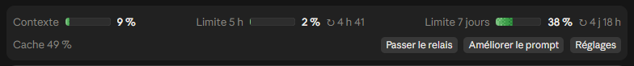

# Claude-Mods

Mes mods pour **Claude Code** : ajouts à l'interface et au comportement de Claude, installés une fois et valables dans tous mes projets.

| Mod | Rôle | État |
|---|---|---|
| **pupitre** | Une bande au-dessus de la zone de texte : ce qui reste (contexte, limites), où en est Claude, et des raccourcis pour fixer la suite, passer le relais ou améliorer une demande | Disponible (version 1.0.2) |

## Aperçu



La bande s'affiche au-dessus de la zone de texte. On y trouve la jauge (mémoire de la conversation, limites sur 5 heures et sur 7 jours), la part de la dernière demande lue dans le cache, et les boutons « Passer le relais », « Améliorer le prompt » et « Réglages ».

**Les barres de travail** (`/fil`) : une par travail en cours. Elles changent de couleur en avançant, et l'étiquette donne l'étape en cours. Les images ci-dessous sont dessinées par le code du mod lui-même :


**La jauge** passe du vert au rouge à mesure qu'elle se remplit :

| Large | À surveiller | Ça presse | Critique |
|---|---|---|---|
|  |  |  |  |
| moins de 50 % | 50 à 75 % | 75 à 90 % | 90 % et plus |

## Installation

À faire **une fois par ordinateur**. Il te faut Claude Code à jour et la commande `claude` dans un terminal (PowerShell sous Windows) : ces commandes ne se tapent pas dans l'onglet Code de l'application.

1. Ajoute le catalogue de mods :
   ```
   claude plugin marketplace add Eiyuo/Claude-Mods
   ```
2. Installe pupitre :
   ```
   claude plugin install pupitre@claude-mods
   ```
3. Ouvre une nouvelle conversation, dans l'application ou dans le terminal : la bande apparaît au-dessus de la zone de texte, tout est allumé. Le mod se charge ensuite tout seul à chaque lancement de Claude. `/pupitre` éteint tout, ou rallume tout.

**Mettre à jour.** Les mises à jour ne sont pas automatiques. Quand une nouvelle version sort, lance ces deux commandes, puis ferme et rouvre Claude :

```
claude plugin marketplace update claude-mods
```

```
claude plugin update pupitre@claude-mods
```

**Désinstaller.**

```
claude plugin uninstall pupitre@claude-mods
```

**Bon à savoir.**
- Les barres animées s'affichent dans l'application de bureau ; dans un terminal, elles sont dessinées en caractères.
- Le carillon de fin ne sonne que sous Windows et macOS.
- Les autres conversations n'apparaissent que si elles tournent sur le même ordinateur.
- La première fois, Claude te demande de faire confiance au dossier ouvert : c'est nécessaire.
- Le mod tourne avec tes droits, comme Claude lui-même : installe-le seulement depuis une source de confiance.

---

## pupitre

### En bref

| Commande | Ce qu'elle fait |
|---|---|
| `/pupitre` | Allume tout d'un coup. Si tout est déjà allumé, éteint tout |
| `/jauge` | Allume ou éteint la jauge (contexte, limites 5 h et 7 jours) |
| `/fil` | Allume ou éteint les barres de progression de Claude et de ses sous-agents |
| `/relais` | Allume ou éteint le bouton « Passer le relais » |
| `/plume` | Allume ou éteint le bouton « Améliorer le prompt » |
| `/cap` | Allume ou éteint le cap automatique : à la fin de chaque réponse, Claude te demande « Et maintenant, on fait quoi ? » avec 3 suites |

À chaque changement, un petit message confirme ce qui est allumé ou éteint, par exemple « Pupitre : fil éteint ». Les réglages sont gardés d'une session à l'autre.

**Sans taper de commande : le bouton « Réglages ».** Il est au bout de la ligne des boutons. Un clic déplie juste en dessous la ligne « Pupitre : ✓ Jauge · ✓ Fil · ✓ Relais · ✓ Plume · ✓ Cap · Tout éteindre · Replier », et, quand le relais est allumé, la ligne « Relais à : − 60 % + · ○ Automatique ». Chaque bouton allume (✓) ou éteint (○) sa fonction ; « Tout éteindre » devient « Tout allumer » dès qu'une fonction est éteinte ; « Replier » range la ligne. Si tu éteins tout, la bande disparaît : tape `/pupitre` pour la rallumer.

### La jauge (`/jauge`)

Une seule ligne, avec trois petites barres :

- **Contexte** : la part de la mémoire de conversation de Claude déjà remplie (par exemple « 42 % · 84 k / 200 k jetons »). Quand elle approche de 100 %, Claude commence à oublier le début : c'est le moment de passer le relais.
- **Limite 5 h** : ta consommation sur la fenêtre de 5 heures, et le temps avant sa remise à zéro.
- **Limite 7 jours** : ta consommation sur la semaine, et le temps avant sa remise à zéro.

Les couleurs :

| Couleur | Signification |
|---|---|
| Vert | Moins de 50 % : large |
| Jaune | De 50 à 75 % : à surveiller |
| Orange | De 75 à 90 % : ça presse |
| Rouge | 90 % et plus : critique, la barre bat comme un cœur |

Le symbole **↻** donne le temps avant la remise à zéro. Chaque texte tient sur une seule ligne. Si la fenêtre est trop étroite, la jauge se resserre dans cet ordre : les barres raccourcissent, puis les « ↻ » quittent la ligne, puis les noms deviennent « 5 h » et « 7 jours ».

Claude Code ne fournit les limites 5 h et 7 jours qu'avec un abonnement (Pro, Max, Team…). Sans abonnement, elles affichent « — ».

Juste sous la jauge, une ligne de boutons, calée à droite : ceux de `/relais` et `/plume` quand ils sont allumés, puis « Réglages ». À gauche, le cache (par exemple « Cache 99 % ⓘ ») : un clic dessus l'explique en une phrase.

**Le cache.** À chaque réponse, Claude ne se souvient de rien tout seul : toute la conversation lui est renvoyée (ses consignes, les messages précédents, les fichiers lus). Pour ne pas tout retraiter à chaque fois, Anthropic garde un moment en mémoire le début de la conversation qui n'a pas changé : c'est le cache. Le pourcentage donne la part de ta dernière demande qui venait de ce cache.
- **Un chiffre haut (souvent 99 %) est le bon cas** : d'un message à l'autre, seuls ton nouveau message et les derniers résultats sont nouveaux. Les réponses sont plus rapides, et la partie relue depuis le cache coûte beaucoup moins cher.
- **Il baisse normalement** au début d'une conversation, après un `/clear` ou un relais (rien n'est encore en mémoire), après une longue pause (le cache expire) ou quand tu changes de modèle.
- **Un chiffre bas qui se répète** au milieu d'une conversation qui avance normalement est le seul signe à surveiller : le travail est alors refait trop souvent.

### Le fil (`/fil`)

**Une ligne par travail.** Toutes les lignes ont les mêmes colonnes, pour que tout reste aligné :

- un point (« ✓ » quand c'est fini) ;
- le début de ta demande, par exemple « Analyse le dossier radar… » ;
- la barre : des pixels nets, du clair au foncé, une bande de lumière qui la balaie, un bord qui clignote tant que ça travaille, et une petite étiquette au bout, avec l'étape en un mot (Lecture, Recherche, Écriture, Commande, Délégation, Web, Question, Réflexion…) ;
- le pourcentage et le temps écoulé ;
- la croix **×**, une fois le travail fini. Sa place est gardée sur chaque ligne : toutes les barres ont la même longueur.

**Comment la barre avance.** Si Claude tient une liste de tâches, la barre avance à chaque tâche finie. Sinon (c'est le cas aujourd'hui : Claude Code ne lui donne pas d'outil de liste de tâches), elle avance par estimation : elle ralentit vers 90 %, puis passe à 100 % à la fin.

**Les couleurs suivent l'avancement :**

| Avancement | Couleur |
|---|---|
| 0 à 33 % | Violet |
| 33 à 66 % | Bleu |
| 66 à 99 % | Turquoise |
| Terminé | Vert, avec « ✓ Fini », un flash et des confettis de pixels |

Quand la barre change de couleur, la nouvelle avance de gauche à droite. **Si rien n'a bougé depuis 20 secondes** (Claude attend ta réponse, une permission, ou réfléchit longuement), la barre pâlit et respire lentement : un coup d'œil suffit pour voir qu'il faut peut-être aller voir.

**Où.** Les barres du fil s'affichent au-dessus de la jauge.

**Les sous-agents.** Quand Claude délègue une partie du travail, chaque sous-agent a sa ligne juste sous celle de Claude (« ↳ 1 · sa description »), avec la même barre. Quand il finit, sa ligne passe au vert et reste affichée jusqu'à la croix.

**À la fin.** Quand Claude a fini de répondre, les barres passent au vert et restent affichées. La croix **×** au bout de la ligne de Claude les retire. Sinon, elles sont remplacées à ta demande suivante. Dès que 2 barres ou plus sont finies (les tiennes comme celles des autres discussions), le bouton **« Effacer les barres finies »** apparaît sur la ligne des boutons : il retire toutes les barres vertes d'un coup et garde celles en cours.

**Les autres discussions.** Si une autre fenêtre de discussion travaille en même temps, elle apparaît dans la même liste, avec le nom de son dossier : « Ajoute du beurre… · essai-relais ». Tu suis ainsi tout ce qui tourne, sans changer de fenêtre. Quand elle a fini, sa ligne passe au vert et reste affichée ; la croix **×** au bout de la ligne la retire.

**Le son.** Un carillon doux de deux notes sonne quand Claude a fini, si la réponse a pris plus de 30 secondes. Pas de son pour les réponses rapides.

Si Windows demande moins d'animations, les étincelles, la bande de lumière, le bord qui clignote, le flash, les confettis et le battement de la jauge sont coupés ; les barres restent lisibles, et une barre en attente reste simplement pâle.

### Fixer le cap (`/cap`)

Tape `/cap` pour allumer (ou éteindre) le cap automatique. Une fois allumé, à la fin de chaque réponse, quand le travail demandé est fini, Claude te demande dans la fenêtre à choix : « Et maintenant, on fait quoi ? », avec 3 suites possibles, sa recommandation en premier. Tu choisis, ou tu tapes autre chose, et il repart.

Pour ça, une courte consigne part avec chacun de tes messages (tu ne la vois pas). Elle ne part pas avec une commande comme `/fil`.

### Passer le relais (`/relais`)

Quand la conversation devient longue (jauge « Contexte » qui se remplit), clique sur **« Passer le relais »** :

1. Claude écrit le fichier **`relais.md`** à la racine du projet ouvert, avec :
   - une ligne pour rouvrir l'ancienne conversation (`claude --resume …`) ;
   - un statut : « À REPRENDRE », ou « ATTENDRE » si la suite dépend d'une décision de ta part ;
   - l'objectif ;
   - les contraintes permanentes ;
   - ta dernière demande, mot pour mot ;
   - ce qui a été fait ;
   - l'état actuel, vérifié juste avant d'écrire (git, tests) plutôt que de mémoire ;
   - comment vérifier (les commandes exactes de test) ;
   - les décisions prises, et pourquoi, et les pistes déjà écartées ;
   - les prochaines étapes (et, si le statut est « ATTENDRE », la question exacte à te poser) ;
   - les blocages ;
   - les fichiers clés.

   80 lignes au plus, sans ton nom, ton identifiant d'entreprise ni le chemin de ton dossier personnel.
2. **`relais.md` n'est jamais enregistré dans git** : il reste sur ton ordinateur (Claude l'exclut de git pour cet ordinateur seulement, sans modifier le projet). Ainsi, il ne peut pas partir sur GitHub avec le reste.
3. La conversation est vidée, et la zone de texte est préremplie avec la phrase de reprise : Claude vérifie que l'état décrit est toujours vrai, résume en 3 lignes où on en est, puis reprend aux prochaines étapes sans refaire ce qui est fait (ou te pose la question en attente si le statut est « ATTENDRE »).
4. Tu n'as plus qu'à appuyer sur Entrée : la nouvelle conversation repart avec tout l'essentiel, et une mémoire neuve.

Pour reprendre sur un autre ordinateur, copie `relais.md` à la racine du projet là-bas.

Si `relais.md` n'a pas pu être écrit, la conversation n'est pas vidée et un message te prévient.

**Au bon moment.** Dans « Réglages », choisis ton seuil (60 % par défaut, de 30 à 90 %). Quand le contexte le dépasse, le bouton affiche le contexte (« Passer le relais · 62 % ») et une notification te prévient une fois. En « Automatique », le relais se lance tout seul à la fin de la réponse qui dépasse le seuil.

### Améliorer le prompt (`/plume`)

Tape (ou dicte) ta demande comme elle te vient, puis clique sur **« Améliorer le prompt »** :

1. Ta demande est réécrite pour être plus précise : le but, le contexte, les contraintes et le résultat attendu. Elle garde ta langue, ton intention et tes contraintes mot pour mot, à peu près la même longueur, et rien n'est inventé. Si un point essentiel est ambigu, elle demande à Claude de te poser la question avant d'agir.
2. La réécriture tient compte de la fin de la conversation (ta dernière demande, la dernière réponse de Claude) : « refais-les » ou « ce fichier » deviennent précis.
3. Elle s'appuie sur ce que Claude a sous la main (skills, commandes, connecteurs, sous-agents), en commençant par ceux qui touchent à ta demande, et cite ceux qui serviront.
4. Le texte amélioré remplace le tien dans la zone de texte. Relis-le, corrige si besoin, puis envoie.
5. Jusqu'à l'envoi, le bouton **« Revenir à mon texte »** permet d'annuler, même après une retouche.

### Où ça marche

| Où | Ce qui s'affiche |
|---|---|
| **Application de bureau Claude** (onglet Code) | Tout, avec les barres animées |
| **Claude dans un terminal** | Tout, mais les barres sont dessinées en caractères (`█▓▒░`), sans animation |
| **`claude -p`, intégrations par programme** | Rien ne s'affiche ; /plume et la fin de /relais ne font rien et le disent |

### Données

Tout reste sur ton PC :
- les réglages ;
- l'avancement partagé entre fenêtres (`~/.claude/pupitre/`) ;
- `relais.md`.

Seule exception : l'amélioration de /plume, qui passe par Claude comme le reste de la conversation.

---

## Pour Claude (développement)

- Conception : `docs/specs/2026-10-11-pupitre-design.md`.
- Pendant le développement, le mod se charge à chaud depuis le dossier des mods de la session.
- Vérifications :
  - `claude plugin validate pupitre` ;
  - `claude plugin test pupitre` ;
  - contrôle des types avec `tsc`.
- Identité des commits : `Eiyuo <203855181+Eiyuo@users.noreply.github.com>`. Ne jamais écrire d'identifiant d'entreprise ni de nom réel dans ce dépôt.
